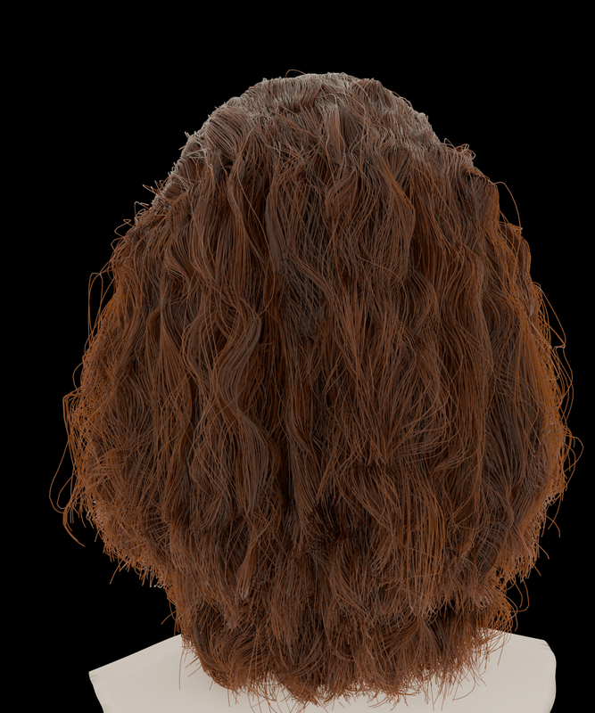
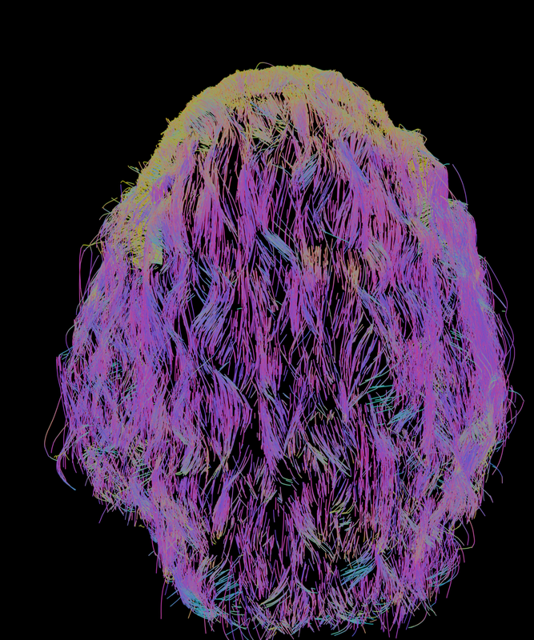
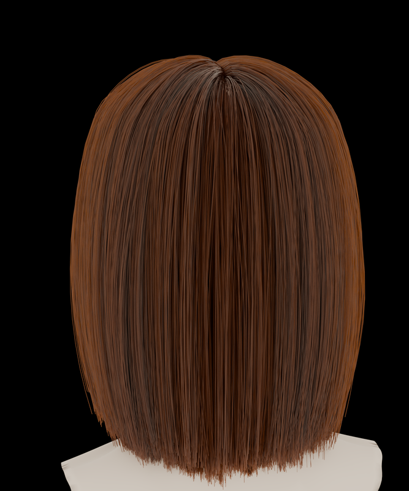
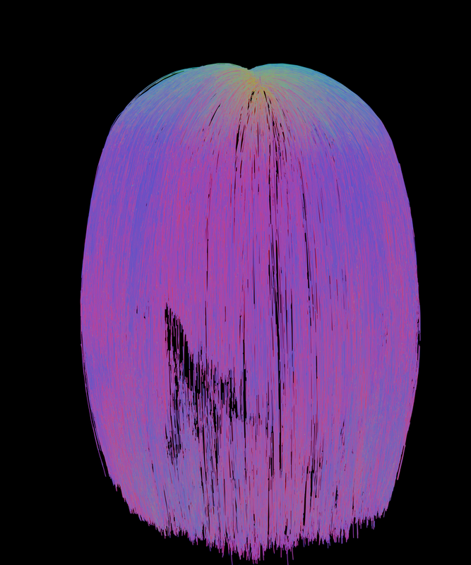
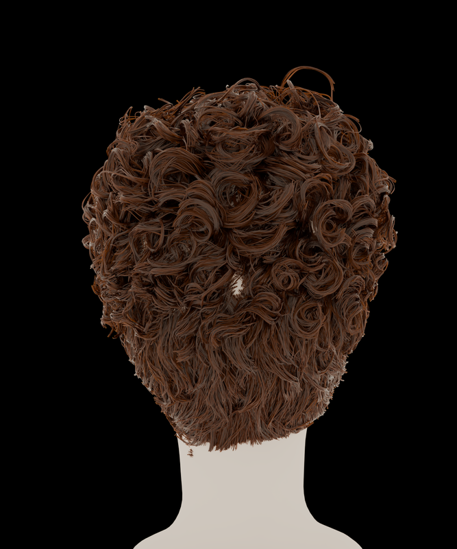
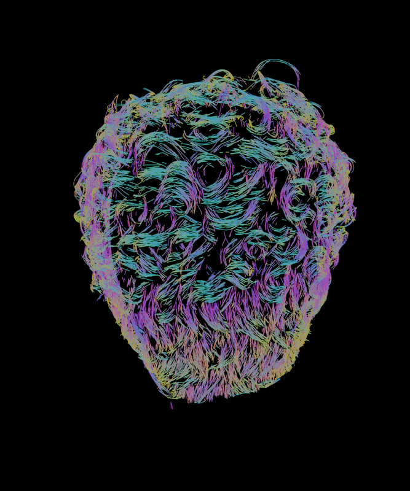
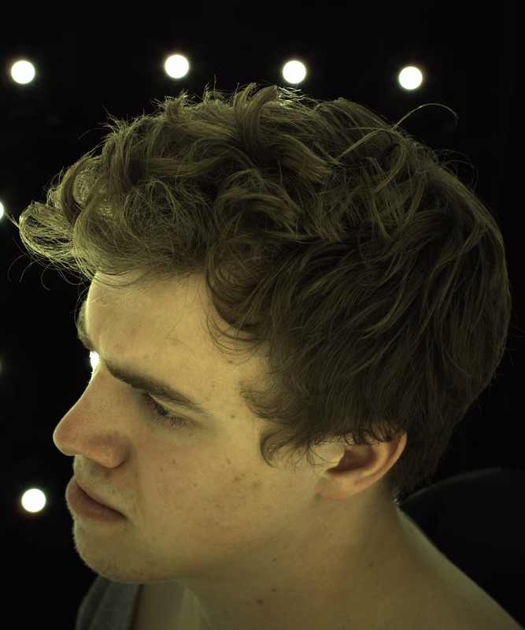
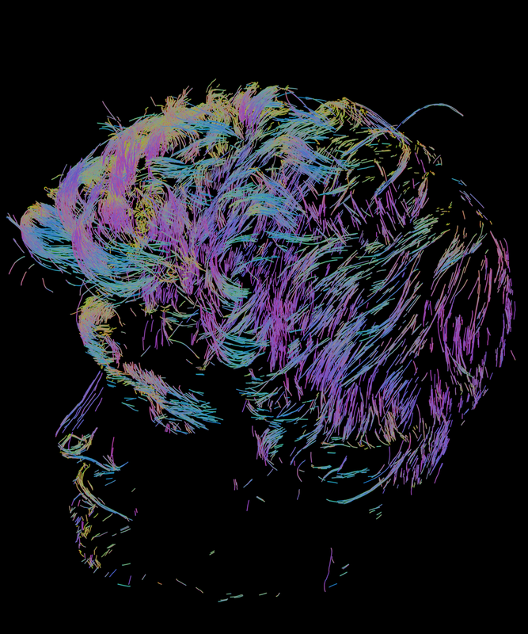

# SMHC-Unofficial-Pytorch
Unofficial, complete, GPU-accelerated implementation of the paper "Strand-accurate Multi-view Hair Capture" (Nam et al., CVPR2019). [[Link to Paper](https://vclab.kaist.ac.kr/cvpr2019p1/Nam_Strand-Accurate_Multi-View_Hair_Capture_CVPR_2019_paper.pdf)]

[](https://github.com/Allrez/SMHC-Unofficial-Pytorch/blob/main/LICENSE)
[](https://github.com/Allrez/SMHC-Unofficial-Pytorch/stargazers)
[](https://github.com/Allrez/SMHC-Unofficial-Pytorch/issues)
[](https://www.linkedin.com/in/allrez/)


## 📢 Disclaimer
This is an **unofficial implementation** and hence, it is not endorsed by, or affiliated with, the original authors or their respective institutions. This code was developed based on the methodologies described in the published paper to facilitate reproducibility in the computer graphics/vision community.

## 💡 About The Project
The goal of this project is to provide a reproducible pipeline for strand-accurate multi-view hair reconstruction, a task notoriously difficult due to the complex geometry and thin structures of human hair.

### Key Features
* **LPMVS (Line-based PatchMatch MVS):** Fully accelerated GPU kernels for patch matching and depth estimation.
* **Point Cloud Filtering:** High-speed outlier removal and statistical filtering implemented in native CUDA.
* **Point Cloud Fusion:** Optimized GPU-accelerated fusion logic to structure the filtered point cloud.
* **Strand Segment Extraction:** Algorithms for generating initial 3D strand segments directly from the fused point cloud, capturing the fine-grained flow of the hair geometry.
* **Multi-View Hair Growing:** A refined "hair growing" algorithm that elongates segments into full-length strands while maintaining multi-view consistency, parallelized using **OpenMP**, providing significant speedups for high-density reconstructions.
* **Evaluation Suite:** Scripts to reproduce the qualitative and quantitative results shown below.

## 📊 Evaluation & Correctness
To ensure the validity of this reimplementation, quantitative and qualitative evaluations have been conducted.

### Quantitative Results
The evaluation is performed using the straight and curly hair models provided by [Cem Yuksel](https://www.cemyuksel.com/research/hairmodels/), which serve as the primary benchmarks in the original paper for quantitative validation, reported as precesion, recall and F1-score.

<table>
  <thead>
    <tr>
      <th>Style</th>
      <th>dist(mm)</th>
      <th>dir(deg.)</th>
      <th>Precision(%)</th>
      <th>Recall(%)</th>
      <th>F1-score</th>
    </tr>
  </thead>
  <tbody>
    <tr>
      <td rowspan="3"><b>Curly</b></td>
      <td>0.50</td>
      <td>5.00</td>
       <td><b>50.91</b>(46.02)</td> 
       <td><b>22.16</b>(14.54)</td> 
       <td><b>30.87</b>(22.10)</td>
    </tr>
    <tr>
      <td>1.00</td>
      <td>10.00</td>
      <td><b>87.02</b>(74.31)</td>
      <td><b>39.25</b>(25.32)</td>
      <td><b>54.10</b>(37.77)</td>
    </tr>
    <tr>
      <td>2.00</td>
      <td>20.00</td>
      <td><b>98.15</b>(94.91)</td>
      <td><b>55.17</b>(43.71)</td>
      <td><b>70.59</b>(59.86)</td>
    </tr>
    <tr>
      <td rowspan="3"><b>Straight</b></td>
      <td>0.50</td>
      <td>5.00</td>
      <td>32.77(<b>72.94</b>)</td>
      <td><b>31.46</b>(23.37)</td>
      <td>32.10(<b>35.39</b>)</td>
    </tr>
    <tr>
      <td>1.00</td>
      <td>10.00</td>
      <td>77.58(<b>92.94</b>)</td>
      <td><b>51.28</b>(31.44)</td>
      <td><b>61.75</b>(46.98)</td>
    </tr>
    <tr>
      <td>2.00</td>
      <td>20.00</td>
      <td>96.41(<b>99.20</b>)</td>
      <td><b>71.96</b>(45.46)</td>
      <td><b>82.41</b>(62.35)</td>
    </tr>
  </tbody>
</table>

<p><i>Table 1: Quantitative metrics for reconstruction of the standard Curly and Straight style synthetic benchmarks (higher is better). Values in parentheses refer to the results reported in the original publication.</i></p>

**Note on Discrepancies:** numerical variances between results of this implementation and the original paper may arise due to differences in synthetic dataset configurations (e.g., camera placement or lighting) and the specific preprocessing steps required to extract the outer surface of ground truth hair strands for comparison.

The soundness and correctness of this reimplementation are further demonstrated through the Qualitative Results in the following section, which showcase the strand-level accuracy and consistency of the reconstructions.

### Qualitative Results
We showcase results on the standard Straight and Curly hair models. These results highlight the pipeline’s ability to reconstruct clean, strand-accurate geometry.

<div style="width: 90%; margin: 0 auto;">
  
  
  
  
  <p><i>
  Figure 1: Visual comparisions for the reconstructions of the standard synthetic Curly and Straight benchmarks.
  </i></p>
</div>

Evaluation on a curly hairstyle from the [CT2Hair](https://github.com/facebookresearch/CT2Hair) dataset demonstrates the implementation's capability to handle dense, high-frequency geometry.
Finally, we test the pipeline on real-world imagery from the [Ava-256 dataset](https://github.com/facebookresearch/ava-256).

<div style="width: 90%; margin: 0 auto;">
  
  
  
  
  <p>
  <i>Figure 2: Further qualitative results.</i>
  </p>
</div>

## 🛠️ Installation
While currently the provided automation scripts are written in Bash for **Linux**, installation for **Windows** is also possible by taking similar steps. On either case, please ensure your system meets the following requirements before proceeding.

### Prerequisites
- **GPU:** A CUDA-capable GPU with drivers supporting **CUDA** $\ge$ **12.4**.
- **Compiler:** A compatible C++ compiler (preferably with **OpenMP** support).
- **Blender: Version 4.2** is required for the synthetic dataset generation script.

```bash
# 1. Clone the repository
git clone https://github.com/Allrez/SMHC-Unofficial-Pytorch.git --recursive
cd SMHC-Unofficial-Pytorch/scripts

# 2. Run the installation script (handles Python env and C++ extensions)
chmod +x install.sh
./install.sh
```

## 💻 Usage
### Common COLMAP input

Cases under `input/real` and `input/synth/ct2hair` can be used directly:

```text
<case_dir>/
├── cropped/images/    # Names referenced by sparse/images.bin, e.g. 0.jpg
├── sparse/
│   ├── cameras.bin
│   ├── images.bin
│   └── points3D.bin
└── head.obj
```

Run from the repository root in the installed Python environment:

```bash
python main.py --dataset_path input/real/20260415/iwata
python main.py --dataset_path input/synth/ct2hair/bangs
```

The output path defaults to `output/<path relative to input>/`, e.g.
`output/real/20260415/iwata/`. Final results are
`multiview_hairgrowing/final_positions.npy`, `final_directions.npy`, and
`final_points_num_per_strand.npy` within that directory. All intermediate maps,
point clouds, strand segments, and `cfg.yaml` are stored under its `work/`
subdirectory. `--output_path` can still override the output directory; resumed
runs and `--initial_depth_maps` use the same `work/` layout.

The loader supports undistorted COLMAP `PINHOLE` and `SIMPLE_PINHOLE` cameras.
Their intrinsics must match the cropped images. Camera translations and the head
mesh are interpreted in millimetres; computation uses metres, and final positions
are saved in millimetres with the input axes unchanged (+Y up, +Z front, +X toward
the model's left). `head.obj` determines the default depth search range with a
150 mm margin. Override it with `--lpmvs_minimum_depth` and
`--lpmvs_maximum_depth` in **metres** if needed. Hair masks and ground-truth hair
are optional; `points3D.bin` is not needed by the reconstruction algorithm.
Existing `calibration.json` datasets remain supported in their original units.

### Step 1: Synthetic Data Generation
Before reconstruction, you can generate the multi-view synthetic dataset using the provided Blender script. This provides 136 viewpoints per model, on a geodesic shell covering mostly the upper hemisphere, at 2048x2048 resolution. Currently .hair, .ply and .bin hair models are supported. For the head model, provide a .ply model and make sure to use a closed (capped) neck on your head model. This prevents the pipeline from reconstructing internal strands that are technically visible through the open hole at the bottom of a standard bust mesh.

```bash
# 3. Generates multi-view renders and ground truth
chmod +x render_synthetic_dataset.sh
./render_synthetic_dataset.sh <path_to_blender_executable> <path_to_input_hair_model> <path_to_input_head_model> <path_to_output_folder>
```
### Step 2: Running Reconstruction
To start the reconstruction process, you can use the provided run script. This script contains the specific configuration for the synthetic and real-world results above.

```bash
# 4. Run the reconstruction
chmod +x run.sh
./run.sh <path_to_input_dataset> <path_to_output_folder>
```

## ⚙️ Configuration & Hyperparameters
The reconstruction behavior is controlled via cfgs/default.yaml. While many parameters follow the original paper's logic, the additional ones are:

**Utilizing masks**
- `--use_hair_masks` causes the pipeline to execute the LPMVS only on the pixels marked as hair, hence, boosting performance. This however, requires you to provide the hair masks somehow!

**Step by step run**
- `--no_lpmvs` skips this step, similarly there are parameters for other steps of the pipeline.

**Quantitative evaluation**
- `--calc_quantitative_measures` calculates and displays the precision, recall and F1-score for the synthetic cases.

**More feedbacks**
- `--verbose` if you are a fan of verbosity!

## ⚡ Performance Benchmarks
To provide a baseline for expected performance, the following benchmarks were recorded using a representative synthetic case (Cem Yuksel's Curly model).

### Hardware Specifications
- **GPU:** NVIDIA GeForce RTX 3090 (24GB VRAM).
- **CPU:** AMD Ryzen 9 5950X (16 Cores).

<table>
  <thead>
    <tr>
      <th>Stage</th>
      <th>Hardware and/or Method</th>
      <th>Avg. Runtime</th>
    </tr>
  </thead>
  <tbody>
    <tr>
       <td rowspan="2">LPMVS</td>
       <td>CUDA</td> 
       <td>~15s(per view)</td>
    </tr>
    <tr>
       <td>CUDA+Hair Masks</td> 
       <td>~4s(per view)</td>
    </tr>
    <tr>
      <td>Point Clound Filtering</td>
      <td>CUDA</td>
      <td>~0.5s(per view)</td>
    </tr>
    <tr>
      <td>Point Clound Fusion</td>
      <td>CUDA</td>
      <td>~60s(~20 million points)</td>
    </tr>
    <tr>
      <td>Strand Segment Extraction</td>
      <td>CPU</td>
      <td>~11s</td>
    </tr>
    <tr>
      <td>Multi-View Hair Growing</td>
      <td>CPU+OpenMP</td>
      <td>~18s</td>
    </tr>
    <tr>
      <td rowspan="2">Total Pipeline</td>
      <td>Without Hair Masks</td>
      <td>~36min</td>
    </tr>
    <tr>
      <td>With Hair Masks</td>
      <td>~12min</td>
    </tr>
  </tbody>
</table>

<p><i>Table 2: Measured runtime for different stages of pipeline on the specified hardware.</i></p>


## 📖 Citation

If you use this work in your research, please cite the original paper to credit the authors' methodology.

Additionally, if this specific implementation (codebase) was helpful to your work, please cite this repository as well. This helps others find the code and supports the maintenance of this project.

**Cite the Original Paper**
```bibtex
@inproceedings{nam2019strand,
  title={Strand-accurate multi-view hair capture},
  author={Nam, Giljoo and Wu, Chenglei and Kim, Min H and Sheikh, Yaser},
  booktitle={Proceedings of the IEEE/CVF Conference on Computer Vision and Pattern Recognition},
  pages={155--164},
  year={2019}
}
```

**Cite this Implementation**
```bibtex
@misc{vafaei2026hair,
  author = {Alireza Vafaei},
  title = {Reimplementation of strand-accurate multi-view hair capture},
  note = {https://github.com/Allrez/SMHC-Unofficial-Pytorch.git},
  year = {2026}
}
```

## ⚖️ License
This project is licensed under the **MIT License**. See the [LICENSE](LICENSE) file for details.
